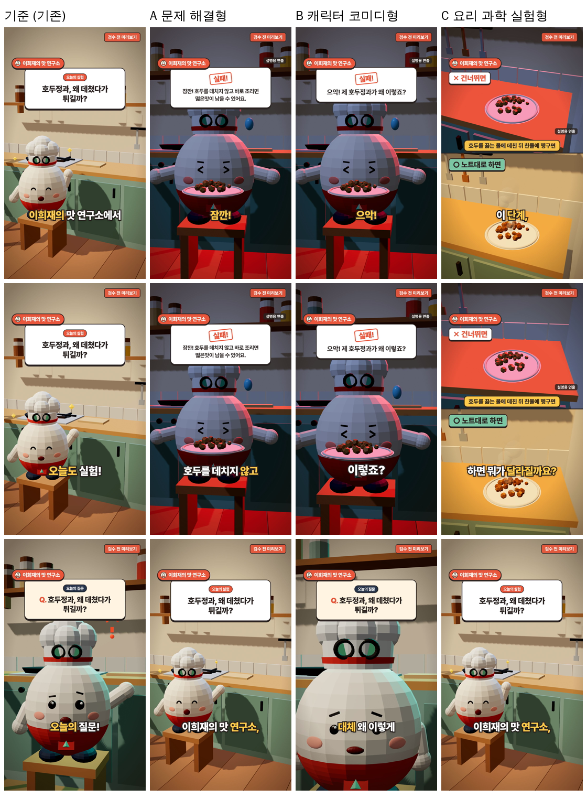

# 파일럿 실험: 호두정과 릴스 A/B/C와 블로그 A/B

- 작성일: 2026-11-03 · 도구: `tools/content-lab/`
- **외부 시청자 반응은 측정하지 않았다.** 이 문서의 비교는 제작물 자체(구성·길이·화면·소리·정보·이름 노출)에 대한 것이다. 조회수·완시율 예측은 쓰지 않는다.
- 모든 파일럿은 **연구자 승인 전 초안**이다. 영상에 "검수 전" 워터마크가 있고, 서명 카드에도 "검수 전 초안"이 나온다.

## 1. 실험 조건

| 항목 | 내용 |
| --- | --- |
| 원본 | `SAMPLE_RECIPES` 호두정과 (재료·분량·순서는 이희재 레시피 원문, 원리·팁 문장은 원래부터 "검수 필요" 초안) |
| A·B용 추가 입력 | 흔한 실수: "호두를 데치지 않고 바로 조리면 떫은맛이 남을 수 있어요." — **원리 문장을 뒤집어 만든 검수 필요 초안**이다. 연구자가 실제로 자주 보는 실수인지 확인되지 않았다 |
| 음성 | VoiceStudio + VoxCPM2(상업 이용 가능), 맛조수 목소리, CPU |
| 렌더 | 이 클라우드 서버(그래픽카드 없음, swangle), 1080×1920, -14 LUFS |
| 기준 영상 | `walnut-jeonggwa.mp4` (기존 템플릿, 음성 캐시 결함 수정 후 재렌더) |

## 2. 대본 비교 (엔진 실제 출력)

### 기준: 기존 템플릿 (walnut-jeonggwa.mp4)
| # | 장면 | 감정 | 화면 연출 | 대사 |
| --- | --- | --- | --- | --- |
| 1 | intro | joy | 기본 | 이희재의 맛 연구소에서 오늘도 실험! |
| 2 | question | curious | 기본 | 오늘의 질문! 호두정과, 왜 데쳤다가 튀길까? |
| 3 | explain | surprised | 기본 | 이희재 연구자의 조리 노트에 따르면, 호두를 끓는 물에 데친 뒤 찬물에 헹구면 떫은맛이 줄어듭니다. |
| 4 | explain | confident | 기본 | 시럽에 조린 호두를 140도 정도의 기름에 튀기면 겉의 시럽이 굳으면서 바삭해집니다. |
| 5 | ingredients | joy | 기본 | 준비물은 이거예요! |
| 6 | steps | confident | 기본 | 순서는 딱 5단계, 전체 과정은 블로그에 정리했어요! |
| 7 | tip | confident | 기본 | 조리기능장 이희재의 한 줄 팁! 튀겨낸 호두는 타공판에 옮겨 키친타올로 기름을 빼 주세요. |
| 8 | outro | joy | 기본 | 저장하고 다음 실험에서 만나요! |

이름 노출: "이희재" 3회, "희재 선생님" 0회, "조리기능장" 1회 · 첫 대사 예상 2.8초

### A 문제 해결형
| # | 장면 | 감정 | 화면 연출 | 대사 |
| --- | --- | --- | --- | --- |
| 1 | mistake (훅) | embarrassed | fail | 잠깐! 호두를 데치지 않고 바로 조리면 떫은맛이 남을 수 있어요. |
| 2 | intro | joy | 기본 | 이희재의 맛 연구소, 오늘의 실험! |
| 3 | explain | surprised | 기본 | 원인은 이거예요. 이희재 연구자의 조리 노트에 따르면, 호두를 끓는 물에 데친 뒤 찬물에 헹구면 떫은맛이 줄어듭니다. |
| 4 | ingredients | joy | 기본 | 준비물은 이거예요! |
| 5 | steps | confident | 기본 | 바른 순서는 딱 5단계, 전체 과정은 블로그에! |
| 6 | tip | confident | 기본 | 조리기능장 이희재의 한 줄 팁! 튀겨낸 호두는 타공판에 옮겨 키친타올로 기름을 빼 주세요. |
| 7 | outro | joy | signature | 다음에 만들 때 꺼내 보게 저장! 이희재의 맛 연구소였어요. |

이름 노출: "이희재" 4회, "희재 선생님" 0회, "조리기능장" 1회 · 첫 대사 예상 4.4초

### B 캐릭터 코미디형
| # | 장면 | 감정 | 화면 연출 | 대사 |
| --- | --- | --- | --- | --- |
| 1 | mistake (훅) | embarrassed | fail | 으악! 제 호두정과가 왜 이렇죠? |
| 2 | question | disappointed | react | 희재 선생님! 대체 왜 이렇게 된 거죠? |
| 3 | explain | surprised | 기본 | 이희재 연구자의 조리 노트에 따르면, 호두를 끓는 물에 데친 뒤 찬물에 헹구면 떫은맛이 줄어듭니다. |
| 4 | explain | confident | 기본 | 시럽에 조린 호두를 140도 정도의 기름에 튀기면 겉의 시럽이 굳으면서 바삭해집니다. |
| 5 | steps | confident | 기본 | 이번엔 제대로! 딱 5단계, 전체 과정은 블로그에! |
| 6 | outro | joy | signature | 대성공! 이희재의 맛 연구소, 다음 실험에서 만나요! |

이름 노출: "이희재" 2회, "희재 선생님" 1회, "조리기능장" 0회 · 첫 대사 예상 2.5초

### C 요리 과학 실험형
| # | 장면 | 감정 | 화면 연출 | 대사 |
| --- | --- | --- | --- | --- |
| 1 | question (훅) | curious | compare | 이 단계, 하면 뭐가 달라질까요? 그림으로 비교해 볼게요! |
| 2 | intro | joy | 기본 | 이희재의 맛 연구소, 오늘의 실험! |
| 3 | explain | surprised | sizzle | 이희재 연구자의 조리 노트에 따르면, 호두를 끓는 물에 데친 뒤 찬물에 헹구면 떫은맛이 줄어듭니다. |
| 4 | explain | confident | 기본 | 시럽에 조린 호두를 140도 정도의 기름에 튀기면 겉의 시럽이 굳으면서 바삭해집니다. |
| 5 | ingredients | joy | 기본 | 준비물은 이거예요! |
| 6 | steps | confident | 기본 | 순서는 딱 5단계, 전체 과정은 블로그에! |
| 7 | tip | confident | 기본 | 조리기능장 이희재의 한 줄 팁! 튀겨낸 호두는 타공판에 옮겨 키친타올로 기름을 빼 주세요. |
| 8 | outro | joy | signature | 오늘의 실험 노트, 저장해 두세요! 이희재의 맛 연구소였어요. |

이름 노출: "이희재" 4회, "희재 선생님" 0회, "조리기능장" 1회 · 첫 대사 예상 4.1초

## 3. 항목별 비교

| 항목 | 기준 (기존) | A 문제 해결형 | B 캐릭터 코미디형 | C 요리 과학 실험형 |
| --- | --- | --- | --- | --- |
| 첫 장면 | 넓은 주방 + "오늘의 실험" 카드, 브랜드 문구 | 실패한 접시를 든 맛조수(어두운 조명) + "실패!" 카드 | 같은 실패 화면, 짧은 감탄 | 위아래 분할: ✕ 건너뛰면 / ○ 노트대로 + 원인 카드 + "설명용 연출" |
| 첫 3초 안의 내용 | 브랜드 문구만 (질문은 2.6초부터) | 실수 문장 (말은 약 5초로 3초 초과) | 감탄 + 질문이 3초 안에 끝남 | 질문 (말은 약 4초로 3초 초과) |
| 훅 문장 | 이희재의 맛 연구소에서 오늘도 실험! | 잠깐! 호두를 데치지 않고… | 으악! 제 호두정과가 왜 이렇죠? | 이 단계, 하면 뭐가 달라질까요? 그림으로 비교해 볼게요! |
| 예상 관심 (가설) | 브랜드를 아는 사람 | "나도 저렇게 하나?" 걱정 | 캐릭터 반응의 재미 | 차이를 보고 싶은 궁금증 |
| 화면 전환 | 장면 종류별 기본 카메라 | 실패 → 넓은 → 조리 → 접시 | 실패 → 얼굴 클로즈업 → 조리 → 성공 접시 | 분할 → 넓은 → 팬 클로즈업 → 조리 |
| 음향 | 목소리만 | 목소리 + 띠용(실패) + 뿅(서명) | 목소리 + 띠용 + 뿅 | 목소리 + 휙(훅) + 뿅 |
| 캐릭터 표현 | 기쁨·궁금함 중심 | 당황 → 자신감 | 당황 → 실망 → 놀람 → 기쁨 (감정 변화 가장 큼) | 궁금함 → 놀람 → 자신감 |
| 정보 명확성 | 원리 2문장 + 재료 + 순서 + 팁 | 원리 1문장(원인) + 재료 + 순서 + 팁 | 원리 2문장 + 순서 (재료 카드·팁 없음) | 원리 2문장 + 재료 + 순서 + 팁 (가장 많음) |
| 전문가 이름 노출 | 대사 3회 (오프닝 브랜드, 노트, 팁) | 대사 4회 + 서명 카드 | 대사 2회 + **"희재 선생님!" 호칭** + 서명 카드 | 대사 4회 + 서명 카드 |
| 정확성 위험 | 낮음 | 실수 문장이 검수 필요 초안 | 실패 장면이 설명용 연출 | 비교 화면이 설명용 연출 (화면 표시) |
| 제작 비용 | 0원 | 0원 | 0원 | 0원 (비교 장면은 3D를 두 번 그려 그 구간 렌더가 느림) |
| 재생성 난이도 | 템플릿 다시 만들기 | 첫 장면만 바꾸기 가능 | 같음 | 같음 |

(측정값은 4절)

## 4. 실측 (2026-11-03 렌더)

위 그림: 각 열은 위에서부터 약 0.3~0.5초, 1.5~2.5초, 3~6초 장면. 기준 영상은 첫 3초 동안 넓은 주방 + 브랜드 문구이고 **음식이 보이지 않는다.** A·B는 첫 프레임부터 실패한 접시와 "실패!" 카드, C는 위아래 비교 화면이 나온다.

| 항목 | 기준 | A 문제 해결 | B 코미디 | C 실험 |
| --- | --- | --- | --- | --- |
| 길이 | 38.3초 | 38.2초 | 29.5초 | 40.8초 |
| 장면 수 | 8 | 7 | 6 | 8 |
| MP4 | H.264/AAC 1080×1920 | 같음 | 같음 | 같음 |
| 음량 (목표 -14 LUFS) | -14.0 | -14.0 | -14.3 | -14.1 |
| 받아쓰기 vs 대본 (장면별 일치율) | 0.83~1.00 | 0.84~1.00 | 0.78~1.00 | 0.83~1.00 |
| 자막 일치율 (자막이 떠 있는 동안 들린 단어가 그 자막에 있는 비율) | 86% | 93% | 82% | 86% |
| 말 시작 vs 자막 시작 | -0.47~+0.02초 | -0.41~0.00초 | -0.48~+0.03초 | -0.41~+0.02초 |
| 첫 화면에 음식 | 없음(3초까지) | 있음 | 있음 | 있음 (두 접시) |
| 첫 대사 길이(실제) | 2.6초 (브랜드) | 약 5초 | 약 2.8초 | 약 4초 |
| 효과음 | 없음 | 띠용·뿅 | 띠용·뿅 | 휙·뿅 |
| "설명용 연출" 표시 | 해당 없음 | 실패 장면 | 실패 장면 | 비교 장면 |
| 렌더 시간(이 서버, CPU) | 28분 | 28분 | 22분 | 31분 (비교 장면을 두 번 그림) |

일치율은 Whisper small 받아쓰기 기준이라 받아쓰기 자체의 오차(예: "으악"을 다르게 받아씀)가 포함된다. B의 1장면(0.78)이 낮은 이유로 보인다.

## 4-1. 영상을 보고 확인한 점 (사람이 할 판단은 남겨 둠)

1. **첫 3초가 가장 크게 달라졌다.** 기준은 브랜드 인사로 시작하고 질문은 2.6초 뒤에 온다. A·B·C는 첫 프레임에 문제(실패 접시) 또는 비교가 나온다. 이것이 시청 유지에 실제로 도움이 되는지는 **트라이얼 릴스로 재 봐야 한다** (hook-library 4절).
2. **A와 C는 첫 대사가 3초를 넘는다** (약 5초, 4초). 엔진은 미리 경고했지만 실제 음성은 예상보다 느렸다. 실수 문장은 화면 카드로 보여 주고 말은 "잠깐! 이거 안 하면 떫어요"처럼 줄이는 편집이 다음 개선점이다. 실수 문장은 연구자가 짧게 입력하도록 안내한다.
3. **B가 가장 짧고(29.5초) 감정 변화가 가장 크다** (당황→실망→놀람→기쁨). 대신 재료 카드와 한 줄 팁이 빠져 정보는 가장 적다. "희재 선생님!" 호칭은 B에만 있다.
4. **C가 정보가 가장 많고 가장 길다** (40.8초). 비교 장면에서 두 접시의 차이가 3D 모델에서는 주로 색(어두운 분홍 vs 금빛)으로만 보여 약하다. **실제 촬영한 비교 사진·클립을 올리면** 실험형의 설득력이 크게 오를 것이다(장면 클립 업로드 기능은 이미 있음).
5. **B 반응 장면의 카드 불일치**를 발견했다: "희재 선생님! 대체 왜…"라고 말하는데 카드는 주제 질문을 보여 줬다. → 렌더 후 수정함(연출 장면의 질문 카드는 말하는 문장을 그대로 보여 줌). 파일럿 영상에는 수정 전 화면이 남아 있다.
6. **서명 카드**는 세 영상 모두 마지막 약 3~4초에 이름·직함 2개·연구소 이름으로 나오고, 승인 전이라 "검수 전 초안"이 표시된다.

## 4-2. 결론 (제작물 기준, 시청자 반응 아님)

| 목적 | 추천 | 이유 |
| --- | --- | --- |
| 실패를 겪어 본 시청자에게 바로 도움 | **A 문제 해결형** (실수 문장을 짧게 고친 뒤) | 첫 화면이 문제, 원인·해결·팁이 모두 있음. 단 실수 문장은 연구자 확인 필수 |
| 캐릭터 인지·이름 호칭 실험 | **B 코미디형** | 가장 짧고 감정 변화가 큼, "희재 선생님!" 호칭. 매번 쓰면 "같은 상황 반복" 정책 위험 → 가끔만 |
| 이유·원리를 알고 싶은 시청자, 블로그로 연결 | **C 실험형** (실제 비교 사진을 올린 뒤) | 정보가 가장 많음. 3D 비교만으로는 차이가 약함 |

첫 실험 제안: **같은 호두정과로 A(짧게 고친 버전)와 C를 트라이얼 릴스로 비교** → 건너뛰기 비율, 평균 시청 시간, 보내기/도달. B는 캐릭터 회차로 따로 운영.

## 5. 블로그 A/B

| 항목 | A 기존 자동 원고 | B 전문가 조리 노트형 (답변 전) |
| --- | --- | --- |
| 파일 | [samples/walnut-blog-A-auto.md](samples/walnut-blog-A-auto.md) | [samples/walnut-blog-B-expert-note.md](samples/walnut-blog-B-expert-note.md) |
| 자연스러움 | 브랜드 인사 + 질문 + 원리 + 재료·순서 + 팁. 어느 요리에나 같은 틀 | 소제목이 독자의 궁금증(핵심 단계, 자주 보는 실패, 줄이는 방법) 순서. 답이 들어가기 전에는 빈칸이 보인다 |
| 정보의 구체성 | 원본 그대로 (원리 2문장, 팁 1개) | 같음 + 답변 칸 3개(핵심 단계·실패·해결)가 채워지면 원본에 없는 실제 판단 신호가 들어간다 |
| 전문성 | 직함이 제목에만 | 제목 "실패 줄이는 법 \| 조리기능장 이희재의 조리 노트", 본문 경험은 연구자 답변 원문 |
| 중복 표현 | 문체 점검 0건 | 문체 점검 0건 |
| 원본 충실도 | 재료·분량·순서 100% 일치 | 같음 (일관성 검사 통과) |
| 실제 경험 반영 | 없음 | **답변 대기** — 질문 3개(필수) + 선택 4개 |
| 일반 독자 이해 | 쉬움, 다만 "왜"에 대한 답이 원리 2문장뿐 | 실패 → 해결 흐름이라 따라 하기 쉬울 것으로 예상(가설) |
| 게시 가능 여부 | 승인 후 가능 | 승인 + 필수 답변 + 연구자 본인 확인 후 가능 |

### 이희재 연구자에게 드릴 질문 (답변 대기)

필수 (전문가 조리 노트형):
1. 가장 중요한 한 단계는 무엇이고, 왜 그런가요?
2. 직접 겪었거나 수업에서 자주 보는 실패는 무엇인가요?
3. 그 실패는 어떻게 고치거나 막나요?

호두정과 심층 인터뷰(선택, [blog-research.md 8장](blog-research.md)): 시럽 판단 신호, 젓는 시점, 튀김 vs 오븐 비교 경험, 정과·강정·빠스 구분과 근거 문헌, 실제 보관 기간 등 17문항.

답을 받으면 같은 화면에서 B 원고가 바로 채워지고, A와 다시 비교한다.
